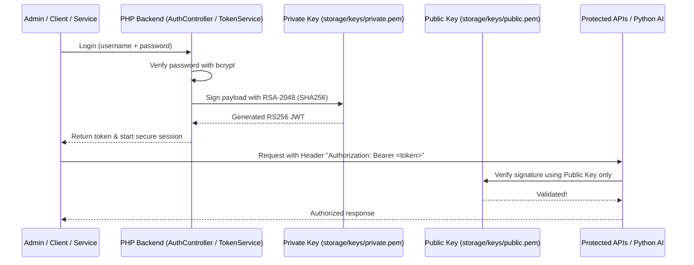

# Architecture Documentation

Plain PHP 8 (Zero external runtime dependencies) + MySQL/MariaDB, structured as an MVC + Service-oriented architecture.

```
ice_ordering_system/
├── public/            Customer-facing storefront (landing, order form, tracking, receipt)
├── admin/             Back-office administration (dashboard, orders, inventory, customers, reports)
├── api/               RESTful JSON endpoints (auth, products, orders, customers, ai)
├── app/               Internal application logic (protected via .htaccess)
│   ├── bootstrap.php       Core initialization, session config, autoloader, helper imports
│   ├── config/             app.php (system settings, SMS & AI config), database.php (PDO)
│   ├── models/             Data models: User, Customer, Product, Order, OrderItem
│   ├── services/           Business services:
│   │                       - TokenService (RS256 Asymmetric JWT generation & verification)
│   │                       - OrderService (transactional checkout & status management)
│   │                       - InventoryService (concurrency-safe stock adjustment & auditing)
│   │                       - AIService (Ollama local LLM proxy & chat)
│   │                       - NotificationService (Semaphore SMS gateway & app logs)
│   ├── controllers/        HTTP controllers: AuthController, OrderController, ProductController, UserController
│   ├── helpers/            auth.php, functions.php, validation.php
│   └── views/              Reusable layout templates (headers, footers, flash messages)
├── storage/           Secured application storage (.htaccess protected)
│   ├── keys/               private.pem (RSA 2048 private key) & public.pem (RSA 2048 public key)
│   └── logs/               app.log
├── ai/                Local AI integration (Ollama CLI assistant & demand forecasting)
├── database/          schema.sql & seed.sql
├── css/ js/ assets/   Frontend styling and behavior scripts
└── index.php          Root router (redirects to public/index.php)
```

---

## Asymmetric Authentication Flow (RS256)



---

## Business Logic & Rules

1. **Server-Side Pricing Authority:** Prices are always calculated server-side from active `products` rows in MySQL; any client-submitted totals are strictly discarded.
2. **Wholesale / Reseller Tiers:** Customers designated as "Reseller" by the store owner automatically receive discounted pricing based on their contact number.
3. **Atomic Stock Decrement:** Stock is deducted using `SELECT ... FOR UPDATE` inside database transactions. When an order is marked `Cancelled`, inventory is immediately replenished and audited.
4. **Resilient AI Fallback:** Ollama operations in `AIService` run with connection timeouts; if Ollama is stopped or unavailable, the website remains 100% operational with a graceful offline notice.
5. **Philippine SMS Notifications:** Supports live SMS via Semaphore API to notify customers and the business owner on orders and delivery status updates.
