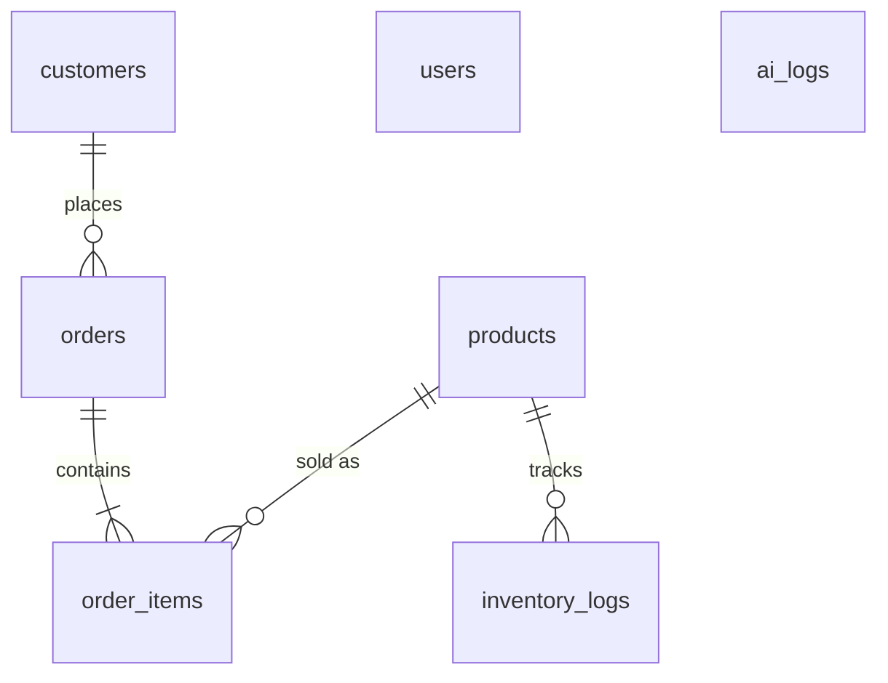

# Database

MySQL/MariaDB, database `ice_ordering_system`, charset `utf8mb4`.

## Setup

1. Start **MySQL** in the XAMPP Control Panel.
2. Run `database/schema.sql` then `database/seed.sql` (from your DB extension, TablePlus/DBeaver, or the terminal):

```powershell
Get-Content database\schema.sql | C:\xampp\mysql\bin\mysql.exe -u root
Get-Content database\seed.sql   | C:\xampp\mysql\bin\mysql.exe -u root
```

> ⚠️ `schema.sql` **drops and recreates** all tables. Don't run it on live data.

Default admin login: **admin / admin123** — change it right away from the admin dashboard.

## Tables



| Table | Purpose |
| --- | --- |
| `users` | Admin/staff logins (bcrypt password hashes) |
| `customers` | Buyers, matched by phone. `customer_type` = Retail / Reseller |
| `products` | Ice catalog with retail + reseller price and current stock |
| `orders` | One row per order: contact, fulfillment, totals, payment, status |
| `order_items` | Line items. Product name and price are copied so old orders stay accurate after price changes |
| `inventory_logs` | Every stock change (order deduction, restock, melted, correction) |
| `ai_logs` | Prompts/replies from the Ollama assistant |

## Order statuses

`Pending → Confirmed → Preparing → Out for Delivery → Completed`, or `Cancelled` (returns stock, final).

